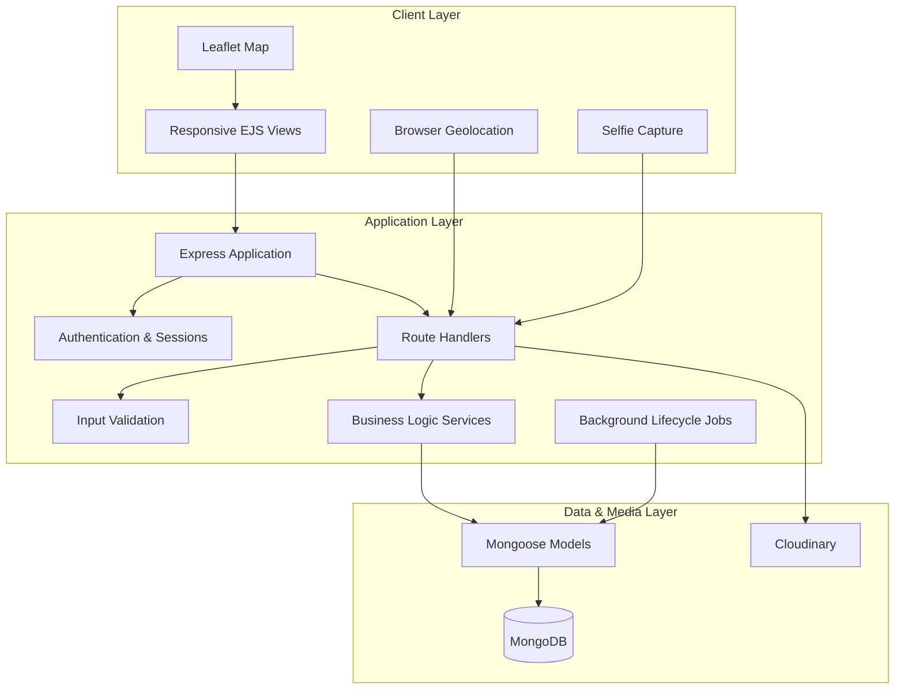
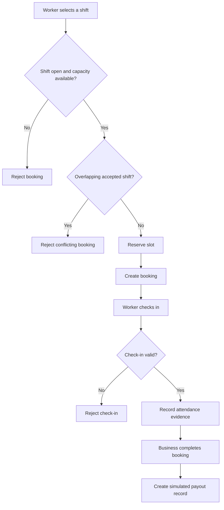

# ⚡ PeakShift
### Making Labor as Flexible as Work Itself

**A hyperlocal, short-duration workforce marketplace that connects businesses facing temporary staffing shortages with workers looking for flexible, nearby earning opportunities.**

PeakShift helps businesses fill short-term staffing gaps and enables workers to discover, book, and complete hourly shifts without committing to long-term employment.

<p align="center">
  <strong>Discover Shifts · Match Locally · Verify Attendance · Track Earnings</strong>
</p>

---

## 📌 Table of Contents

- [Overview](#-overview)
- [Problem Statement](#-problem-statement)
- [Our Solution](#-our-solution)
- [Key Features](#-key-features)
- [How It Works](#-how-it-works)
- [System Architecture](#-system-architecture)
- [Technology Stack](#-technology-stack)
- [Application Structure](#-application-structure)
- [Database Design](#-database-design)
- [Core Workflows](#-core-workflows)
- [Security and Reliability](#-security-and-reliability)

## 🎯 Overview

Businesses such as cafés, restaurants, cloud kitchens, retail stores, and event venues often experience sudden increases in demand. Hiring permanent employees for every peak period is expensive, while traditional staffing arrangements may be too slow or inflexible.

At the same time, students, part-time workers, and people seeking additional income need flexible work opportunities that fit their schedules and are located close to them.

**PeakShift bridges this gap through a digital micro-shift marketplace.**

Businesses can publish short-duration shifts with defined roles, working hours, pay rates, and staffing requirements. Workers can discover relevant opportunities, check availability, reserve a slot, verify their attendance, and track their earnings.

### Who is PeakShift for?

| Businesses | Workers |
|---|---|
| Restaurants and cafés | College students |
| Cloud kitchens | Part-time workers |
| Retail stores | Freelancers seeking hourly work |
| Event organizers | People seeking flexible income |
| Small and local businesses | Workers looking for nearby shifts |

## 🚨 Problem Statement

### For businesses
- Unexpected demand creates temporary staffing shortages.
- Traditional hiring processes are often too slow for immediate requirements.
- Hiring full-time employees for short peak periods can increase operational costs.
- Managing worker availability, attendance, and payments across multiple shifts can be difficult.

### For workers
- Finding short-duration work opportunities nearby can be challenging.
- Many jobs require fixed schedules or longer-term commitments.
- Workers may lack clear information about shift duration, total earnings, and remaining vacancies.
- Attendance records, work history, and payment breakdowns may not be transparent.

## 💡 Our Solution

PeakShift introduces a structured marketplace where businesses and workers can coordinate temporary staffing through a single application.

The platform focuses on:

- **Hyperlocal discovery:** Find shifts based on proximity, location, skills, and timing.
- **Flexible staffing:** Publish and fill short-duration work opportunities.
- **Controlled booking:** Track available slots and prevent overbooking through conditional database updates.
- **Attendance verification:** Combine location checks with selfie evidence during check-in.
- **Reputation and accountability:** Maintain ratings and trust scores based on work history.
- **Transparent earnings:** Provide workers and businesses with simulated payout records and spending summaries.
- **Automated operations:** Handle shift expiration, missed check-ins, and notifications through background processing.

## ✨ Key Features

### 1. Business Shift Management

Businesses can create and manage staffing opportunities with structured details, including:

- Job title and role description
- Required skills and worker count
- Shift start and end times
- Hourly pay rate and estimated total compensation
- Workplace address and geographic location
- Shift status and staffing progress

**Availability tracking:** Visual indicators display filled positions, remaining vacancies, and overall staffing progress.

**Controlled editing:** Important shift terms are restricted from modification after workers have accepted slots, helping protect workers against significant changes to agreed conditions.

**Cancellation management:** Businesses can cancel shifts and notify affected workers through the platform.

### 2. Hyperlocal Shift Discovery

Workers can browse opportunities based on their location and preferences.

Features include:

- Nearby shift discovery using geographic coordinates
- Distance-based search with configurable radius options
- Search by job title and role
- Skill-based filtering
- Minimum hourly pay filtering
- Time-based filters for upcoming shifts
- Sorting by proximity, start time, and pay
- Map-based shift location visualization
- Fallback to a saved location when live browser location is unavailable, where supported

The application uses MongoDB geospatial queries and distance calculations to support location-aware discovery.

### 3. Worker Booking and Slot Management

Workers can reserve available positions in a shift.

The booking workflow includes:

- Availability validation before accepting a booking
- Prevention of duplicate or overlapping accepted shifts
- Automatic updates to filled-slot counts
- Automatic closure when staffing capacity is reached
- Cancellation of accepted bookings before the shift begins
- Restoration of available capacity when a booking is cancelled

Conditional database updates help protect against multiple workers attempting to claim the same final vacancy.

### 4. Location-Based Attendance Verification

PeakShift includes a check-in workflow intended to improve attendance accountability.

- Browser-based geolocation captures the worker's current coordinates.
- The server checks whether the worker is within the configured distance of the workplace.
- Check-in is restricted to the permitted time window.
- Workers submit a selfie as photographic evidence.
- Attendance records retain relevant timestamps and location information.

Selfie submission is used as supporting evidence; it should not be interpreted as automated facial recognition or guaranteed liveness detection.

### 5. Trust and Reputation System

PeakShift maintains trust and rating information for workers and businesses.

- Ratings and written reviews
- Work completion and no-show history
- Dynamic trust-score recalculation
- Initial trust-score baseline for new accounts
- Restrictions on reviews to eligible completed bookings
- Protection against duplicate reviews for the same booking

This system is designed to encourage accountability and help participants make more informed decisions.

### 6. Automated Shift Lifecycle Management

A background process periodically evaluates shift and booking states.

It supports:

- Expiration of unfilled shifts whose start times have passed
- Detection of accepted bookings that remain unchecked-in beyond the configured grace period
- No-show status updates
- Trust-score adjustments associated with missed shifts
- Notifications about relevant status changes

These automated transitions reduce the need for manual intervention in routine operations.

### 7. Notifications and Alerts

The notification system keeps participants informed about important events.

Examples include:

- New shift opportunities for nearby workers with matching skills
- Worker booking confirmations for businesses
- Check-in updates
- Shift cancellation or modification alerts
- Payout-status notifications
- No-show and other booking lifecycle updates
- Unread notification counts and notification inbox management

The current implementation uses periodic polling for unread notification counts rather than a persistent WebSocket connection.

### 8. Earnings and Spending Analytics

PeakShift provides financial visibility through application-level ledger records.

**Worker earnings dashboard**
- Daily, weekly, monthly, and overall earnings summaries
- Shift-wise earnings history
- Gross pay and platform-fee breakdowns
- Net payout calculations

**Business spending dashboard**
- Aggregate staffing expenditure
- Platform-fee summaries
- Worker-wise payout breakdowns
- Shift-related financial records

The current payout flow is a simulation for demonstrating the workflow. It does not represent a live banking, UPI, or payment-gateway integration.

### 9. Responsive User Interface

The application uses server-rendered EJS views with responsive styling to present:

- Shift listings and detailed shift pages
- Business dashboards and worker rosters
- Booking and check-in interfaces
- Earnings and spending pages
- Notification interfaces
- Map-based location information

The interface emphasizes practical shift information, including timing, location, hourly compensation, and staffing capacity.

## 🔄 How It Works

### Business workflow

1. A business creates an account and accesses its business dashboard.
2. It publishes a shift with role, timing, pay, location, and staffing requirements.
3. PeakShift makes the opportunity discoverable to eligible workers.
4. Workers accept available slots.
5. The business monitors bookings and attendance.
6. After the shift, the business marks eligible workers as completed.
7. The application generates the corresponding simulated payout records and updates relevant statistics.

### Worker workflow

1. A worker creates an account and provides relevant profile information.
2. The worker explores available shifts.
3. Filters help narrow opportunities by distance, role, skills, timing, and pay.
4. The worker reserves an available slot.
5. At the workplace, the worker completes the configured location and selfie check-in process.
6. The booking progresses through its lifecycle.
7. The worker can review completed work, earnings records, notifications, and eligible reviews.

## 🏗️ System Architecture

PeakShift follows a modular, server-rendered application architecture built around Node.js, Express, MongoDB, and EJS.



### Architectural responsibilities

| Layer | Responsibility |
|---|---|
| Client and views | Render pages, forms, dashboards, maps, and interactive browser features |
| Routes | Receive HTTP requests and direct them to the appropriate operations |
| Controllers | Coordinate request handling and application responses |
| Middleware | Handle authentication, authorization, ownership checks, and request processing |
| Services | Encapsulate core operations such as booking and related state transitions |
| Models | Define data structures, relationships, and database interactions |
| Utilities | Provide reusable validation, geographic calculations, and trust-score logic |
| Database | Persist users, shifts, bookings, notifications, reviews, and transactions |
| Media storage | Store uploaded check-in evidence through Cloudinary |
| Background processing | Evaluate time-dependent shift and booking lifecycle changes |

The architecture separates routing, business logic, persistence, and reusable utilities to make the application easier to maintain and extend.

## 🛠️ Technology Stack

| Technology | Purpose |
|---|---|
| Node.js | JavaScript runtime |
| Express.js 5 | Server-side application and routing |
| EJS and EJS-Mate | Server-rendered templates and reusable layouts |
| MongoDB | Persistent application data |
| Mongoose | Database models and queries |
| Passport.js | Authentication strategy integration |
| Express Session | Session-based authentication state |
| Connect-Mongo | MongoDB-backed session storage |
| Joi | Request and data validation |
| Cloudinary | Check-in selfie storage |
| Multer | Multipart upload handling |
| Leaflet | Interactive maps |
| Bootstrap 5 | Responsive interface styling |
| Geospatial utilities | Distance calculations and location-aware workflows |
| Helmet | HTTP security headers |
| Express Rate Limit | Request rate limiting |
| dotenv | Environment-based configuration |

## 📂 Application Structure

```text
PeakShift/
├── config/          # Application and service configuration
├── controllers/     # Request handling and application workflows
├── init/            # Database initialization and seed scripts
├── models/          # Mongoose schemas and data models
├── public/          # Static assets, stylesheets, and client-side scripts
├── routes/          # Application route definitions
├── services/        # Core business logic and reusable operations
├── utils/            # Validation and utility functions
├── views/           # EJS templates and page layouts
├── app.js            # Application entry point
├── cloudConfig.js    # Cloudinary integration configuration
├── middleware.js     # Shared authentication and request middleware
├── schema.js         # Validation schema definitions
├── package.json      # Dependencies and npm scripts
└── README.md
```

## 🗄️ Database Design

The application uses MongoDB collections represented by Mongoose models.

| Entity | Purpose |
|---|---|
| User | Stores account information, role, skills, location, and reputation data |
| Listing | Represents a shift posted by a business |
| Booking | Connects a worker to a shift and tracks booking and attendance status |
| Notification | Stores user notifications and read status |
| Review | Records eligible ratings and feedback between participants |
| Transaction | Stores simulated payout and platform-fee records |

### Core relationships

- A business user can create multiple shift listings.
- A listing can have multiple worker bookings.
- A worker can have multiple bookings across different shifts.
- Bookings can generate corresponding transaction records.
- Completed bookings can support eligible reviews.
- Users can receive multiple notifications.

### Data integrity considerations

The application uses conditional updates to manage shift capacity and prevent overbooking. Booking overlap checks help avoid conflicting accepted shifts, while transaction uniqueness constraints help prevent duplicate ledger entries for the same booking.

Geospatial fields support location-aware queries where configured.

## ⚙️ Core Workflows

### Booking lifecycle



### Shift lifecycle

A shift may progress from open to filled, cancelled, or expired depending on staffing capacity, cancellation actions, and time-based lifecycle rules.

Booking states track the worker's progress, including accepted, checked-in, completed, cancelled, or no-show states where applicable.

The application treats shift status and booking status as separate concepts so that a shift can contain multiple workers whose bookings progress independently.

## 🔐 Security and Reliability

PeakShift incorporates several application-level safeguards:

- **Authentication:** Session-based authentication using Passport.js.
- **Role-based authorization:** Worker and business access restrictions.
- **Ownership validation:** Business operations are restricted to authorized owners of relevant shifts.
- **Input validation:** Joi schemas validate supported request fields and constraints.
- **Booking integrity:** Conditional capacity updates and overlapping-shift checks.
- **Transaction integrity:** Unique booking references for payout records.
- **Request protection:** Security middleware and rate-limiting dependencies.
- **Session persistence:** MongoDB-backed session storage.
- **Safer search handling:** User search terms are escaped where used in regular-expression matching.

Security controls should be reviewed and tested as part of deployment. In particular, production deployments need secure cookie configuration, correct CSRF protection, secret management, and appropriate handling of sensitive location and selfie data.


## 👨‍💻 Project

**PeakShift — Making Labor as Flexible as Work Itself**

Repository: [github.com/bhav-1007/PeakShift](https://github.com/bhav-1007/PeakShift)

Built to explore how software can make temporary staffing more accessible, location-aware, and accountable for both businesses and workers.